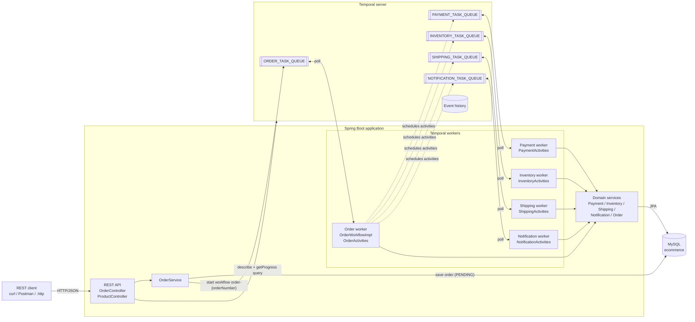
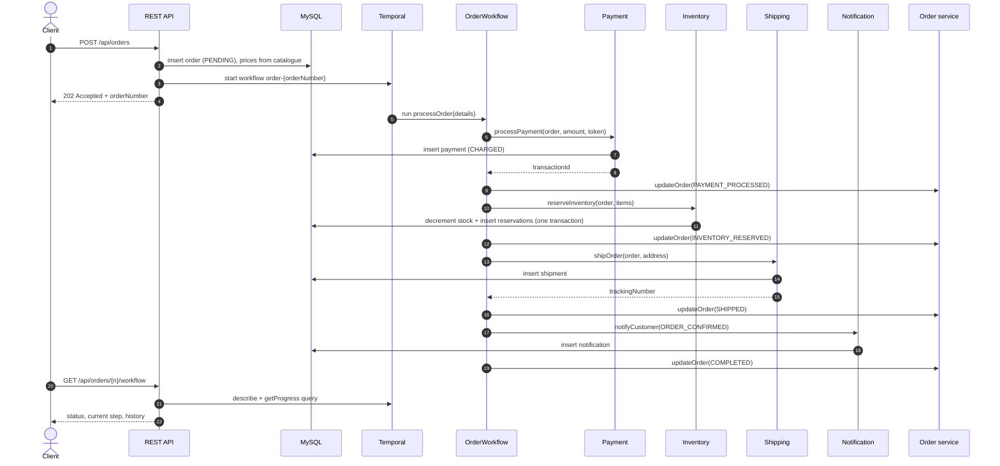
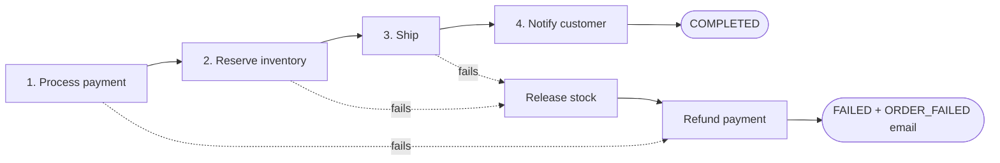
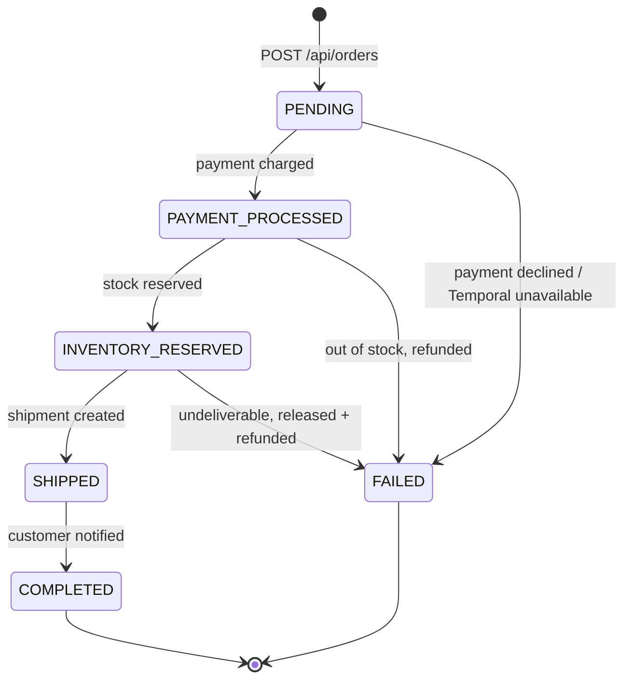
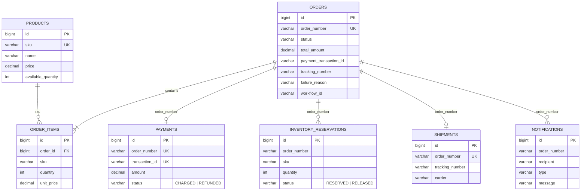

# ecommerce-backend

E-commerce order fulfilment backend in **Java 17 / Spring Boot 3.5**, orchestrated with the
**Temporal Java SDK** and persisted in **MySQL**.

When an order is placed, a Temporal workflow runs the complete order flow:

```
POST /api/orders ──► OrderWorkflow (ORDER_TASK_QUEUE)
                       1. processPayment     ──► Payment service       (PAYMENT_TASK_QUEUE)
                       2. reserveInventory   ──► Inventory service     (INVENTORY_TASK_QUEUE)
                       3. shipOrder          ──► Shipping service      (SHIPPING_TASK_QUEUE)
                       4. notifyCustomer     ──► Notification service  (NOTIFICATION_TASK_QUEUE)
                       + updateOrder after each step ──► Order service (ORDER_TASK_QUEUE)
```

- **Each service has its own Temporal task queue.** The workflow calls the services through Temporal,
  never directly, so each service can run (and scale) in its own process.
- **Retries:** transient errors are retried automatically (1s initial backoff, x2, up to 5 attempts).
- **Saga / compensation:** permanent failures (card declined, out of stock, undeliverable address)
  are non-retryable. The workflow then releases reserved stock, refunds the payment, marks the order
  `FAILED` and emails the customer.
- **Idempotent activities:** every service keys its work on the order number, so retries never
  double-charge, double-reserve, double-ship or send duplicate emails.
- **Live status:** the workflow exposes a `getProgress()` query, surfaced at
  `GET /api/orders/{orderNumber}/workflow`.

## Architecture

### Components



The system has three layers:

| Layer | Classes | Responsibility |
|-------|---------|----------------|
| **API** | `OrderController`, `ProductController`, `ApiExceptionHandler` | Validates requests, saves the order, starts the workflow, exposes order/workflow/audit views. |
| **Orchestration** | `OrderWorkflowImpl` | Decides *what happens next*: step order, retries, compensation. Deterministic code only: no I/O, clocks or randomness. |
| **Services** | `*ActivitiesImpl` → `PaymentService`, `InventoryService`, `ShippingService`, `NotificationService`, `OrderService` | Do the actual work (DB writes, simulated external calls). Activities are thin adapters that turn business errors into non-retryable Temporal failures. |

The workflow never calls a service directly. It schedules an activity on that service's **task queue**,
Temporal stores the request durably, and whichever worker polls that queue runs it. That is what makes
the services independently deployable, and why an order survives a crash or restart of any process: on
restart, the workflow is replayed from its event history and continues from the last completed step.

### Order flow



`POST /api/orders` returns as soon as the workflow has *started*; the client polls the order or the
`/workflow` endpoint to follow progress. The order row is committed before the workflow starts, so
activities can always find it. If Temporal is unreachable the order is marked `FAILED` and the API
returns `503`.

### Failure handling

**Retries.** Every activity runs with a 30s start-to-close timeout and this retry policy: first retry
after 1s, backoff ×2, at most 30s between attempts, 5 attempts in total. Timeouts, exceptions and
worker crashes are all retried. Try it with `paymentToken: tok_flaky`.

**Permanent failures** are raised as non-retryable `ApplicationFailure`s, so they stop immediately:

| Step | Failure type | Trigger in this demo |
|------|--------------|----------------------|
| Payment | `PaymentDeclined` | `tok_declined`, `tok_insufficient_funds` |
| Inventory | `OutOfStock` | quantity greater than available stock |
| Shipping | `UndeliverableAddress` | address contains `UNDELIVERABLE` |

**Compensation (saga).** Before each step runs, the workflow registers its undo action with a Temporal
`Saga`. When a step fails permanently, the undo actions run in reverse order:



Undo actions are registered *before* their step, so a payment that went through but whose activity
timed out is still refunded. Both undo actions are safe no-ops when there is nothing to undo.
A failed notification is logged but does not undo a shipped order.

**Idempotency.** Temporal guarantees at-least-once activity execution, so each service checks for
existing work by order number before acting: an existing payment, reservation set, shipment or
notification of the same type is returned instead of being created again.

### Order status lifecycle



The status is stored in `orders.status` (written by the order service) and is also kept in the
workflow's `getProgress()` query, together with the current step and a step-by-step history.

### Data model



Each service owns its own tables and links to the order only by `order_number`, so the services could
later be split into separate databases without changing the workflow. Stock is decremented with a
single conditional `UPDATE ... WHERE available_quantity >= qty`, so concurrent orders cannot oversell.
Tables are created by Hibernate (`ddl-auto: update`); use a migration tool such as Flyway in production.

### Deployment options

| Mode | How | When |
|------|-----|------|
| **Single process** (default) | `WORKERS=order,payment,inventory,shipping,notification` | Local development and demos |
| **One process per service** | Start the same jar several times with different `WORKERS` values | Scale or deploy services independently; see [below](#running-services-as-separate-processes) |

In every mode, the REST API runs in each process and all processes share the same Temporal namespace
and MySQL database. For production, replace the Temporal dev server with a self-hosted cluster or
Temporal Cloud (`TEMPORAL_TARGET`, `TEMPORAL_NAMESPACE`), and the simulated payment, shipping and
email logic in the services with real provider calls.

## Project layout

```
src/main/java/com/example/ecommerce
├── config/        Temporal client + workers, properties, product seed data
├── domain/        JPA entities: CustomerOrder, OrderItem, Product, Payment,
│                  InventoryReservation, Shipment, Notification
├── repository/    Spring Data repositories
├── service/       Business logic per service (payment, inventory, shipping, notification, order)
├── temporal/
│   ├── workflow/    OrderWorkflow + OrderWorkflowImpl (the order flow)
│   ├── activities/  One activity interface + impl per service
│   ├── model/       Workflow input/output/progress POJOs
│   └── TaskQueues   Task queue names
└── web/           REST controllers, DTOs, error handling
```

## Prerequisites

- JDK 17+, Maven 3.9+
- [Temporal CLI](https://docs.temporal.io/cli) (`temporal --version`)
- MySQL 8 (a local install, or `docker compose up -d`, which starts one on port 3307)

## Run it

1. **Start Temporal** (dev server; the Web UI is at http://localhost:8233):

   ```bash
   temporal server start-dev --db-filename temporal-dev.db
   ```

2. **Start the backend.** The database `ecommerce` and all tables are created automatically.
   Set your MySQL credentials:

   ```bash
   DB_USERNAME=root DB_PASSWORD=<your-password> mvn spring-boot:run
   ```

   On Windows PowerShell: `$env:DB_PASSWORD="<your-password>"; mvn spring-boot:run`

   | Env var            | Default                  |
   |--------------------|--------------------------|
   | `DB_HOST` / `DB_PORT` / `DB_NAME` | `localhost` / `3306` / `ecommerce` |
   | `DB_USERNAME` / `DB_PASSWORD`     | `root` / `root`          |
   | `TEMPORAL_TARGET`  | `localhost:7233`         |
   | `TEMPORAL_NAMESPACE` | `default`              |
   | `WORKERS`          | `order,payment,inventory,shipping,notification` |
   | `SERVER_PORT`      | `8080`                   |

### Running services as separate processes

By default one JVM hosts all five workers. To run them as separate services, start the jar several
times with different `WORKERS` values (and different ports):

```bash
mvn -DskipTests package
WORKERS=order SERVER_PORT=8080 java -jar target/ecommerce-backend-0.0.1-SNAPSHOT.jar
WORKERS=payment SERVER_PORT=8081 java -jar target/ecommerce-backend-0.0.1-SNAPSHOT.jar
WORKERS=inventory,shipping,notification SERVER_PORT=8082 java -jar target/ecommerce-backend-0.0.1-SNAPSHOT.jar
```

Stop the payment process while an order is in flight: the workflow waits at the payment step and
carries on as soon as the payment service comes back.

## REST API

| Method | Path                                   | Description |
|--------|----------------------------------------|-------------|
| GET    | `/api/products`                        | List products and stock |
| GET    | `/api/products/{sku}`                  | One product |
| PUT    | `/api/products`                        | Create or update a product (incl. restock) |
| POST   | `/api/orders`                          | Place an order and start its workflow (202 Accepted) |
| GET    | `/api/orders`                          | List orders |
| GET    | `/api/orders/{orderNumber}`            | Order as stored in MySQL |
| GET    | `/api/orders/{orderNumber}/workflow`   | Temporal execution status + live progress query |
| GET    | `/api/orders/{orderNumber}/audit`      | Payment, reservations, shipment and notifications for the order |

Place an order:

```bash
curl -X POST http://localhost:8080/api/orders -H "Content-Type: application/json" -d '{
  "customerName": "Jane Doe",
  "customerEmail": "jane@example.com",
  "shippingAddress": "221B Baker Street, London",
  "paymentToken": "tok_visa",
  "items": [ { "sku": "LAPTOP-001", "quantity": 1 }, { "sku": "MOUSE-001", "quantity": 2 } ]
}'
```

Then follow it with `GET /api/orders/{orderNumber}/workflow` and `/audit`, or in the Temporal Web UI
(workflow id `order-{orderNumber}`).

[`api-requests.http`](api-requests.http) contains ready-made requests for every scenario.

### Test scenarios

| Input                                   | Result |
|-----------------------------------------|--------|
| `paymentToken: tok_visa`                | `COMPLETED`: charged, reserved, shipped, customer emailed |
| `paymentToken: tok_flaky`               | Payment fails twice, Temporal retries, then `COMPLETED` |
| `paymentToken: tok_declined` / `tok_insufficient_funds` | `FAILED` at payment, nothing reserved or shipped |
| quantity > stock (e.g. 5 × `MONITOR-001`) | `FAILED`: payment refunded |
| address containing `UNDELIVERABLE`      | `FAILED`: stock released, payment refunded |

Seeded products: `LAPTOP-001`, `PHONE-001`, `HEADPHONES-001`, `MOUSE-001`, `MONITOR-001` (stock 2).

## Tests

```bash
mvn test
```

`OrderWorkflowTest` runs the real workflow on Temporal's in-memory test server with fake services on
each task queue. It covers the happy path, retried transient errors, a declined payment and
out-of-stock compensation. These tests need neither MySQL nor a Temporal server.

Notifications are simulated: each one is logged and stored in the `notifications` table.
